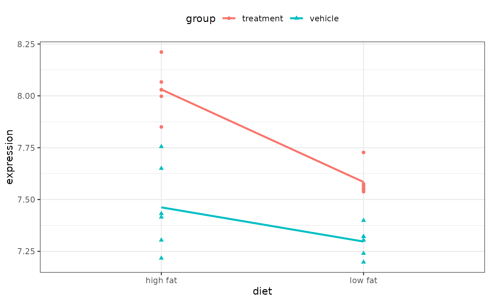
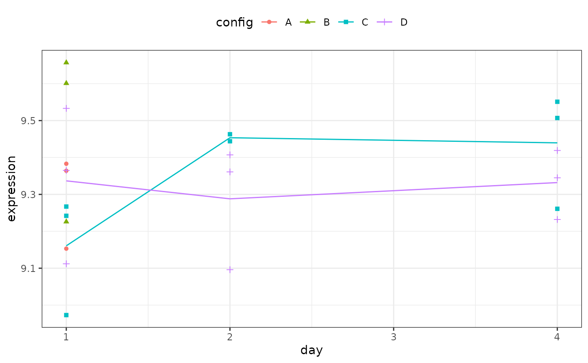

# Contrast Methods

## Introduction

The purpose of the `contrast` package is to provide a standardized
interface for testing linear combinations of parameters from common
regression models. The syntax mimics the `contrast.Design` function from
the `Design` library. The contrast class has been extended in this
package to linear models produced using the functions `lm`, `glm`,
`gls`, `lme` and `geese`. Other `R` functions with similar purposes
exist in `R`, but the interfaces are different and many require the user
to specify the contrast in terms of the parameter contrast coefficient
vector. This package aims to simplify the process for the user.

## Contrasts

First, some notation:

\$\$\begin{align} n &= \text{number of samples} \notag \\ p &=
\text{number of model parameters associated with fixed effects
(excluding the intercept)} \notag \\ q &= \text{number of covariance
parameters with random effects or correlations } \notag \\ Y &=
\text{\$n\times 1\$ response vector} \notag \\ X &= \text{\$n\times
(p+1)\$ model matrix} \notag \\ \beta &= \text{model parameters
associated with fixed effects} \notag \\ \Sigma &= \text{covariance
matrix associated with the fixed effects} \notag \\ \end{align}\$\$

This package uses one degree of freedom Wald tests to calculate p–values
for linear combinations of parameters. For example, the basic linear
model is of the form $`y=X\beta+\epsilon`$, where the individual errors
are assumed to be iid $`N(0, \sigma^2)`$. Ordinary least squares
provides us with estimates $`\hat{\beta}`$, $`\hat{\sigma}^2`$ and
$`\hat{\Sigma}`$. Given a $`(p+1)\times 1`$ vector of constants, $`c`$,
we can estimate a linear combination of parameters $`\lambda = c'\beta`$
by substituting the estimated parameter vectors:
$`\hat{\lambda} = c'\hat{\beta}`$. Using basic linear algebra,
$`Var[\lambda] =  c'\Sigma c`$. The statistic generated for contrasts is

``` math
S = \frac{c'\hat{\beta}}{\sqrt{c'\hat{\Sigma} c}} 
```

For linear models with normal errors, $`S\sim T_{n-p-1}`$ and there is
no uncertainty about the distribution of the test statistic and the
degrees of freedom. In other cases, this is not true. Asymptotics come
into play for several models and there is some ambiguity as to whether a
$`t`$ or normal distribution should be used to compute p–values (See
Harrell, 2001, Section 9.2 for a discussion). We follow the conventions
of each package: `glm`, `gls` and `lme` models use a $`t`$ distribution
and a normal distribution is used for `gee` models. For models where
there are extra covariance or correlation parameters, we again follow
the lead of the package. For `gls` model, the degrees of freedom are
$`n-p`$, while in `lme` models, it is $`n-p-q`$.

The remainder of this document shows two examples and how the `contrast`
function can be applied to different models.

### Linear Models

As an example, a gene expression experiment was run to assess the effect
of a compound under two different diets: high fat and low fat. The main
comparisons of interest are the difference between the treated and
untreated groups within a diet. The interaction effect was a secondary
hypothesis. For illustration, we only include the expression value of
one of the genes.

A summary of the design:

``` r

library(contrast)
library(dplyr)
two_factor_crossed %>% 
  group_by(diet, group) %>% 
  count()
#> # A tibble: 4 × 3
#> # Groups:   diet, group [4]
#>   diet     group         n
#>   <fct>    <fct>     <int>
#> 1 high fat treatment     6
#> 2 high fat vehicle       6
#> 3 low fat  treatment     6
#> 4 low fat  vehicle       6
```

The study design was a two–way factorial with $`n=24`$:

    #> `geom_smooth()` using formula = 'y ~ x'



The cell means can be labeled as:

|          | Low Fat | High Fat |
|----------|---------|----------|
| Vehicle  | `A`     | `B`      |
| Compound | `C`     | `D`      |

The reference cell used by R is cell $`D`$: the treated samples on a
high fat diet.

The model used is

\$\$\begin{align} \log\text{Expression}\_2 &= \beta_0 \notag \\ & +
\beta_1\text{Vehicle Group} \notag \\ & + \beta_2\text{Low Fat Diet}
\notag \\ & + \beta\_{3}\text{Low Fat Diet and Vehicle Group}
\end{align}\$\$

so that $`p=3`$. Substituting the appropriate coefficients into each
cell produces the parameters:

|          | Low Fat                                     | High Fat             |
|----------|---------------------------------------------|----------------------|
| Vehicle  | $`\beta_0 + \beta_1 + \beta_2 + \beta_{3}`$ | $`\beta_0 +\beta_1`$ |
| Compound | $`\beta_0 + \beta_2`$                       | $`\beta_0`$          |

This means that

- $`\beta_2`$ tests for diet effect in the treated samples ($`C-D`$)
- $`\beta_1`$ tests for a compounds effect in the high fat diet samples
  ($`B-D`$)

Fitting the model specified by using
[`lm()`](https://rdrr.io/r/stats/lm.html):

``` r

lm_fit_1 <- lm(expression ~ (group + diet)^2, data = two_factor_crossed)
summary(lm_fit_1)
#> 
#> Call:
#> lm(formula = expression ~ (group + diet)^2, data = two_factor_crossed)
#> 
#> Residuals:
#>     Min      1Q  Median      3Q     Max 
#> -0.2452 -0.0467 -0.0145  0.0275  0.2928 
#> 
#> Coefficients:
#>                          Estimate Std. Error t value Pr(>|t|)    
#> (Intercept)                8.0308     0.0522  153.90  < 2e-16 ***
#> groupvehicle              -0.5687     0.0738   -7.71  2.1e-07 ***
#> dietlow fat               -0.4463     0.0738   -6.05  6.5e-06 ***
#> groupvehicle:dietlow fat   0.2815     0.1044    2.70    0.014 *  
#> ---
#> Signif. codes:  0 '***' 0.001 '**' 0.01 '*' 0.05 '.' 0.1 ' ' 1
#> 
#> Residual standard error: 0.128 on 20 degrees of freedom
#> Multiple R-squared:  0.845,  Adjusted R-squared:  0.821 
#> F-statistic: 36.3 on 3 and 20 DF,  p-value: 2.79e-08
```

To test the treatment effect in the high fat diet, $`D-B = -\beta_1`$.
This coefficient and hypothesis test for the difference between treated
and un-treated in the high fat diet group is in the row labeled as
`groupvehicle` in the output of
[`summary.lm()`](https://rdrr.io/r/stats/summary.lm.html).

To compare the compound data and the vehicle data in the low fat diet
group, the information above can be used to derive that:

\$\$\begin{align} C - A &= \beta_0 + \beta_2
-(\beta_0+\beta_1+\beta_2+\beta\_{3}) \notag \\ &= -\beta_1 - \beta\_{3}
\notag \end{align}\$\$

This hypothesis translates to testing $`\beta_1 + \beta_{3} = 0`$, or a
contrast using $`c=(0, 1, 0, 1)`$. To get the results of the difference
between treated and un-treated in the low fat diet group, we (finally)
use the contrast function:

``` r

high_fat <- contrast(lm_fit_1, 
                     list(diet = "low fat", group = "vehicle"),
                     list(diet = "low fat", group = "treatment"))
print(high_fat, X = TRUE)
#> lm model parameter contrast
#> 
#>  Contrast   S.E.  Lower  Upper     t df Pr(>|t|)
#>    -0.287 0.0738 -0.441 -0.133 -3.89 20    9e-04
#> 
#> Contrast coefficients:
#>  (Intercept) groupvehicle dietlow fat groupvehicle:dietlow fat
#>            0            1           0                        1
```

While the effect of treatment is significantly different when compared
to vehicle for both diets, the difference is more pronounced in the high
fat diet.

Alternatively, both test can be done in the same call to
[`contrast()`](https://rdrr.io/pkg/rms/man/contrast.html):

``` r

trt_effect <-
  contrast(
    lm_fit_1,
    list(diet = levels(two_factor_crossed$diet), group = "vehicle"),
    list(diet = levels(two_factor_crossed$diet), group = "treatment")
  )
print(trt_effect, X = TRUE)
#> lm model parameter contrast
#> 
#>  Contrast   S.E.  Lower  Upper     t df Pr(>|t|)
#>    -0.569 0.0738 -0.723 -0.415 -7.71 20    0e+00
#>    -0.287 0.0738 -0.441 -0.133 -3.89 20    9e-04
#> 
#> Contrast coefficients:
#>  (Intercept) groupvehicle dietlow fat groupvehicle:dietlow fat
#>            0            1           0                        0
#>            0            1           0                        1
```

Also, we can use the `type` argument to compute a single treatment
effect averaging over the levels of the other factor:

``` r

mean_effect <-
  contrast(
    lm_fit_1,
    list(diet = levels(two_factor_crossed$diet), group = "vehicle"),
    list(diet = levels(two_factor_crossed$diet), group = "treatment"),
    type = "average"
  )  
  
print(mean_effect, X = TRUE)
#> lm model parameter contrast
#> 
#>   Contrast   S.E.  Lower  Upper    t df Pr(>|t|)
#> 1   -0.428 0.0522 -0.537 -0.319 -8.2 20        0
#> 
#> Contrast coefficients:
#>   (Intercept) groupvehicle dietlow fat groupvehicle:dietlow fat
#> 1           0            1           0                      0.5
```

Additionally, for ordinary linear regression models, there is an option
to use sandwich estimates for the covariance matrix of the parameters.
See the [sandwich](https://cran.r-project.org/package=sandwich) package
for more details. Going back to our comparison of treated versus control
in low fat samples, we can use the HC3 estimate in the contrast.

``` r

high_fat_sand <- 
  contrast(
    lm_fit_1, 
    list(diet = "low fat", group = "vehicle"),
    list(diet = "low fat", group = "treatment"),
    covType = "HC3"
  )
print(high_fat_sand)
#> lm model parameter contrast
#> 
#>  Contrast   S.E. Lower  Upper     t df Pr(>|t|)
#>    -0.287 0.0447 -0.38 -0.194 -6.43 20        0
#> 
#> The HC3 covariance estimator was used.
```

The $`t`$-statistic associated with the sandwich estimate is -6.427
versus -3.891 using the traditional estimate of the covariance matrix.

### Generalized Linear Model

In this class of models, the distributional assumptions are expanded
beyond the normal distribution to the general exponential family. Also,
these models are linear in the sense that they are linear on a specified
scale. The link function, denoted as $`\eta`$, is a function that
defines how the linear predictor, $`x'\beta`$, enters the model. While
there are several approaches to testing for statistical differences
between models, such as the likelihood ratio or score tests, the Wald
test is another method for assessing the statistical significance of
linear combinations of model parameters. The basic Wald-type test uses
the familiar statistic shown above to evaluate hypotheses. The
distributional properties are exact for the normal distribution and
asymptotically valid for other distributions in the exponential family.
There are some issues with the Wald test (see Hauck and Donner, 1977).
Whenever possible, likelihood ratio or score statistics are preferred,
but these tests cannot handle some types of hypotheses, in which case
the Wald test can be used.

For the previous example, it is customary to log transform gene
expression data using a base of 2, we can illustrate contrasts in
generalized linear models using the log (base $`e`$) link. In this case,
the actual model being fit is $`\exp(x'\beta)`$.

``` r

glm_fit_1 <- glm(2^expression ~ (group + diet)^2, 
                 data = two_factor_crossed, 
                 family = gaussian(link = "log"))
summary(glm_fit_1)
#> 
#> Call:
#> glm(formula = 2^expression ~ (group + diet)^2, family = gaussian(link = "log"), 
#>     data = two_factor_crossed)
#> 
#> Coefficients:
#>                          Estimate Std. Error t value Pr(>|t|)    
#> (Intercept)                5.5693     0.0277  201.36  < 2e-16 ***
#> groupvehicle              -0.3884     0.0493   -7.88  1.5e-07 ***
#> dietlow fat               -0.3110     0.0468   -6.65  1.8e-06 ***
#> groupvehicle:dietlow fat   0.1893     0.0773    2.45    0.024 *  
#> ---
#> Signif. codes:  0 '***' 0.001 '**' 0.01 '*' 0.05 '.' 0.1 ' ' 1
#> 
#> (Dispersion parameter for gaussian family taken to be 316)
#> 
#>     Null deviance: 43574.7  on 23  degrees of freedom
#> Residual deviance:  6312.5  on 20  degrees of freedom
#> AIC: 211.8
#> 
#> Number of Fisher Scoring iterations: 4
high_fat <- 
  contrast(glm_fit_1, 
           list(diet = "low fat", group = "vehicle"),
           list(diet = "low fat", group = "treatment")
  )
print(high_fat, X = TRUE)
#> glm model parameter contrast
#> 
#>  Contrast   S.E.  Lower   Upper     t df Pr(>|t|)
#>    -0.199 0.0596 -0.323 -0.0749 -3.34 20   0.0032
#> 
#> Contrast coefficients:
#>  (Intercept) groupvehicle dietlow fat groupvehicle:dietlow fat
#>            0            1           0                        1
```

The coefficients and p-values are not wildly different given that the
scale is slightly different (i.e. log$`_2`$ versus log$`_e`$).

### Generalized Least Squares

In a second gene expression example, stem cells were differentiated
using a set of factors (such as media types, cell spreads etc.). These
factors were collapsed into a single cell environment configurations
variable. The cell lines were assays over three days. Two of the
configurations were only run on the first day and the other two were
assays at baseline.

To get the materials, three donors provided materials. These donors
provided (almost) equal replication across the two experimental factors
(day and configuration). A summary of the design.

``` r

library(tidyr)

two_factor_incompl %>% 
  group_by(subject, config, day) %>% 
  count() %>% 
  ungroup() %>% 
  pivot_wider(
    id_cols = c(config, day),
    names_from = c(subject),
    values_from = c(n)
  )
#> # A tibble: 8 × 5
#>   config   day donor1 donor2 donor3
#>   <fct>  <dbl>  <int>  <int>  <int>
#> 1 A          1      1      1      1
#> 2 B          1      1      1      1
#> 3 C          1      1      1      1
#> 4 C          2      1     NA      1
#> 5 C          4      1      1      1
#> 6 D          1      1      1      1
#> 7 D          2      1      1      1
#> 8 D          4      1      1      1
```

The one of the goals of this experiment was to assess pre-specified
differences in the configuration at each time point. For example, the
differences between configurations A and B at day one is of interest.
Also, the differences between configurations C and D at each time points
were important.

Since there are missing cells in the design, it is not a complete
two-way factorial. One way to analyze this experiment is to further
collapse the time and configuration data into a single variable and then
specify each comparison using this factor.

For example:

``` r

two_factor_incompl %>% 
  group_by(group) %>% 
  count()
#> # A tibble: 8 × 2
#> # Groups:   group [8]
#>   group     n
#>   <fct> <int>
#> 1 1:A       3
#> 2 1:B       3
#> 3 1:C       3
#> 4 1:D       3
#> 5 2:C       2
#> 6 2:D       3
#> 7 4:C       3
#> 8 4:D       3
```

Using this new factor, we fit a linear model to this one-way design. We
should account for the possible within-donor correlation. A generalized
least square fit can do this, where we specify a correlation structure
for the residuals. A compound-symmetry (a.k.a. exchangeable) correlation
structure assumes that the within-donor correlation is constant.

The mdoel fit is:

``` r

gls_fit <-  gls(expression ~ group, 
               data = two_factor_incompl, 
               corCompSymm(form = ~ 1 | subject))
summary(gls_fit)
#> Generalized least squares fit by REML
#>   Model: expression ~ group 
#>   Data: two_factor_incompl 
#>     AIC   BIC logLik
#>   -6.19 0.889   13.1
#> 
#> Correlation Structure: Compound symmetry
#>  Formula: ~1 | subject 
#>  Parameter estimate(s):
#>   Rho 
#> 0.882 
#> 
#> Coefficients:
#>             Value Std.Error t-value p-value
#> (Intercept)  9.30    0.0981    94.8  0.0000
#> group1:B     0.19    0.0477     4.1  0.0010
#> group1:C    -0.14    0.0477    -2.9  0.0105
#> group1:D     0.04    0.0477     0.8  0.4536
#> group2:C     0.06    0.0540     1.2  0.2656
#> group2:D    -0.01    0.0477    -0.3  0.8046
#> group4:C     0.14    0.0477     2.9  0.0103
#> group4:D     0.03    0.0477     0.7  0.5122
#> 
#>  Correlation: 
#>          (Intr) grp1:B grp1:C grp1:D grp2:C grp2:D grp4:C
#> group1:B -0.243                                          
#> group1:C -0.243  0.500                                   
#> group1:D -0.243  0.500  0.500                            
#> group2:C -0.214  0.441  0.441  0.441                     
#> group2:D -0.243  0.500  0.500  0.500  0.441              
#> group4:C -0.243  0.500  0.500  0.500  0.441  0.500       
#> group4:D -0.243  0.500  0.500  0.500  0.441  0.500  0.500
#> 
#> Standardized residuals:
#>    Min     Q1    Med     Q3    Max 
#> -1.581 -0.727  0.430  0.609  1.155 
#> 
#> Residual standard error: 0.17 
#> Degrees of freedom: 23 total; 15 residual
```

In this example, $`n=23`$ and $`p=8`$. This model estimates the residual
variance and the within-subject correlation, so $`q=2`$. The default
parameter estimates compare each group to the reference cell (day 1,
configuration A). The summary table provides one of the p-values that we
are interested in (configuration A vs. B at day 1). An example of
obtaining the other p-values is shown below:

``` r

print(
  contrast(
    gls_fit,
    list(group = "4:C"),
    list(group = "4:D")
  ),
  X = TRUE)     
#> gls model parameter contrast
#> 
#>   Contrast   S.E.   Lower Upper    t df Pr(>|t|)
#> 1    0.108 0.0477 0.00608 0.209 2.26 15   0.0392
#> 
#> Contrast coefficients:
#>   (Intercept) group1:B group1:C group1:D group2:C group2:D group4:C group4:D
#> 1           0        0        0        0        0        0        1       -1
```

    #> Warning: The `fun.y` argument of `stat_summary()` is deprecated as of ggplot2 3.3.0.
    #> ℹ Please use the `fun` argument instead.
    #> This warning is displayed once per session.
    #> Call `lifecycle::last_lifecycle_warnings()` to see where this warning was
    #> generated.



### Linear Mixed Models via `lme`

A similar model can be fit using a linear mixed model via the
[`lme()`](https://rdrr.io/pkg/nlme/man/lme.html) function. In this case,
we can add a random intercept attributable to the donors. This can
produce the above compound symmetry model, but here the within
donor-correlation is constrained to be positive.

``` r

lme_fit <-  lme(expression ~ group, data = two_factor_incompl, random = ~1|subject)
summary(lme_fit)
#> Linear mixed-effects model fit by REML
#>   Data: two_factor_incompl 
#>     AIC   BIC logLik
#>   -6.19 0.889   13.1
#> 
#> Random effects:
#>  Formula: ~1 | subject
#>         (Intercept) Residual
#> StdDev:        0.16   0.0584
#> 
#> Fixed effects:  expression ~ group 
#>             Value Std.Error DF t-value p-value
#> (Intercept)  9.30    0.0981 13    94.8  0.0000
#> group1:B     0.19    0.0477 13     4.1  0.0013
#> group1:C    -0.14    0.0477 13    -2.9  0.0119
#> group1:D     0.04    0.0477 13     0.8  0.4555
#> group2:C     0.06    0.0540 13     1.2  0.2683
#> group2:D    -0.01    0.0477 13    -0.3  0.8051
#> group4:C     0.14    0.0477 13     2.9  0.0117
#> group4:D     0.03    0.0477 13     0.7  0.5137
#>  Correlation: 
#>          (Intr) grp1:B grp1:C grp1:D grp2:C grp2:D grp4:C
#> group1:B -0.243                                          
#> group1:C -0.243  0.500                                   
#> group1:D -0.243  0.500  0.500                            
#> group2:C -0.214  0.441  0.441  0.441                     
#> group2:D -0.243  0.500  0.500  0.500  0.441              
#> group4:C -0.243  0.500  0.500  0.500  0.441  0.500       
#> group4:D -0.243  0.500  0.500  0.500  0.441  0.500  0.500
#> 
#> Standardized Within-Group Residuals:
#>    Min     Q1    Med     Q3    Max 
#> -1.484 -0.462  0.038  0.171  1.580 
#> 
#> Number of Observations: 23
#> Number of Groups: 3

print(
  contrast(
    lme_fit, 
    list(group = "4:C"),
    list(group = "4:D")
  ),
  X = TRUE)        
#> lme model parameter contrast
#> 
#>   Contrast   S.E.  Lower Upper    t df Pr(>|t|)
#> 1    0.108 0.0477 0.0047 0.211 2.26 13   0.0417
#> 
#> Contrast coefficients:
#>   (Intercept) group1:B group1:C group1:D group2:C group2:D group4:C group4:D
#> 1           0        0        0        0        0        0        1       -1
```

Comparing this to the `gls` model results, the default coefficients have
identical parameter estimates, standard errors and test statistics, but
their $`p`$-values are slightly different. This is due to the difference
in how the degrees of freedom are calculated between these models. The
same is true for the example contrast for the two models (15 versus 13
degrees of freedom).

### Generalized Estimating Equations

Yet another way to fit a model to these data would be to use a
generalized linear model-type framework using normal errors and a log
(base 2) link. To account for the within-donor variability, a
generalized estimating equation approach can be used. We use the
`geese()` function in the `geepack` package.

``` r

gee_fit <-  geese(2^expression ~ group,
                  data = two_factor_incompl,
                  id = subject,
                  family = gaussian(link = "log"),
                  corstr = "exchangeable")
summary(gee_fit)
#> 
#> Call:
#> geese(formula = 2^expression ~ group, id = subject, data = two_factor_incompl, 
#>     family = gaussian(link = "log"), corstr = "exchangeable")
#> 
#> Mean Model:
#>  Mean Link:                 log 
#>  Variance to Mean Relation: gaussian 
#> 
#>  Coefficients:
#>             estimate  san.se     wald        p
#> (Intercept)  6.45772 0.02639 5.99e+04 0.00e+00
#> group1:B     0.13579 0.05026 7.30e+00 6.89e-03
#> group1:C    -0.10870 0.02107 2.66e+01 2.49e-07
#> group1:D     0.02970 0.03896 5.81e-01 4.46e-01
#> group2:C     0.04652 0.00956 2.37e+01 1.13e-06
#> group2:D    -0.01977 0.02398 6.80e-01 4.10e-01
#> group4:C     0.08521 0.02097 1.65e+01 4.83e-05
#> group4:D     0.00784 0.01492 2.76e-01 5.99e-01
#> 
#> Scale Model:
#>  Scale Link:                identity 
#> 
#>  Estimated Scale Parameters:
#>             estimate san.se wald      p
#> (Intercept)     3634   1393  6.8 0.0091
#> 
#> Correlation Model:
#>  Correlation Structure:     exchangeable 
#>  Correlation Link:          identity 
#> 
#>  Estimated Correlation Parameters:
#>       estimate san.se wald       p
#> alpha    0.608  0.234 6.77 0.00925
#> 
#> Returned Error Value:    0 
#> Number of clusters:   6   Maximum cluster size: 7

print(
  contrast(
    gee_fit, 
    list(group = "4:C"),
    list(group = "4:D")
  ),
  X = TRUE)   
#> geese model parameter contrast
#> 
#>   Contrast   S.E.  Lower Upper    Z df Pr(>|Z|)
#> 1   0.0774 0.0295 0.0195 0.135 2.62 NA   0.0088
#> 
#> Contrast coefficients:
#>   (Intercept) group1:B group1:C group1:D group2:C group2:D group4:C group4:D
#> 1           0        0        0        0        0        0        1       -1
```

For this model, a simple Wald test is calculated. The contrast shows a
more significant p-value than the other models, partly due to the scale
and partly due to the distributional assumptions about the test
statistic.

## Fold changes

The [`contrast()`](https://rdrr.io/pkg/rms/man/contrast.html) method
also computes fold changes using the follow process:

- For the two groups defined by the `a` and `b` arguments, the predicted
  outcomes are computed. When the model objects is generated by either
  `glm` or `geese`, the linear predictor is calculated.
- The two predicted values are optionally transformed by the `fcFunc`
  argument. For our gene expression example, we might use , while for
  generalized linear models we might use the inverse link function from
  the `family` object.
- The predicted value for the `a` group is divided by the predicted
  value for the `b` group.
- If the `fcType` argument is `"simple"`, the ratio is returned as the
  fold change. `fcType = "log"` returns the log (base $`e`$) of the
  ratio. If the type is `"signed"`, a different calculation is used. If
  the simple ratio is less than one, the negative reciprocal of the
  ratio is returned; otherwise the fold change is equal to the simple
  ratio

The fold change results are contained in the output as `foldchange`.
From the first example:

``` r

trt_effect <- 
  contrast(lm_fit_1, 
           list(diet = levels(two_factor_crossed$diet), group = "vehicle"),
           list(diet = levels(two_factor_crossed$diet), group = "treatment"),
           fcfunc = function(u) 2^u
  )  
print(trt_effect, X = TRUE)
#> lm model parameter contrast
#> 
#>  Contrast   S.E.  Lower  Upper     t df Pr(>|t|)
#>    -0.569 0.0738 -0.723 -0.415 -7.71 20    0e+00
#>    -0.287 0.0738 -0.441 -0.133 -3.89 20    9e-04
#> 
#> Contrast coefficients:
#>  (Intercept) groupvehicle dietlow fat groupvehicle:dietlow fat
#>            0            1           0                        0
#>            0            1           0                        1
trt_effect$foldChange
#>    [,1]
#> 1 0.929
#> 2 0.962
```

## References

- Harrell, F. E. (2001), *Regression Modeling Strategies*. New York:
  Springer-Verlag.

- Hauck, W. W. and Donner, A. (1977), Wald’s Test as Applied to
  Hypotheses in Logit Analysis. *Journal of the American Statistical
  Association*, 72, 851-863.
